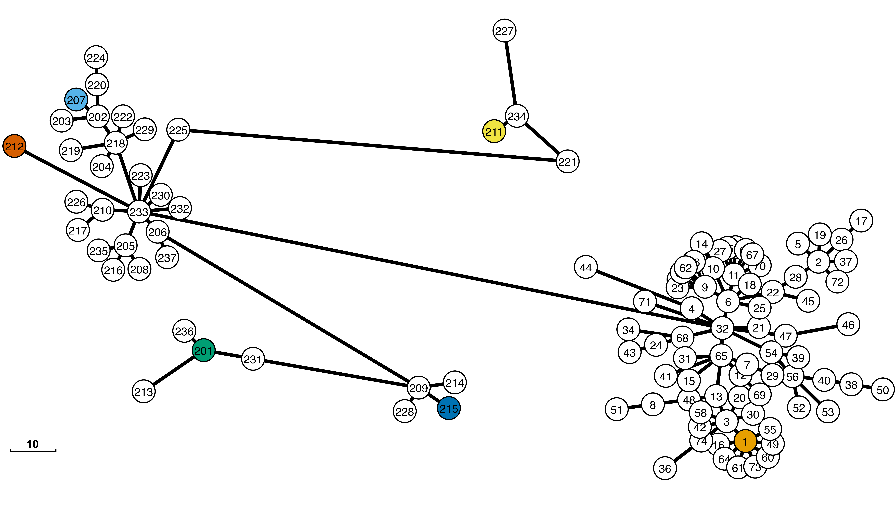
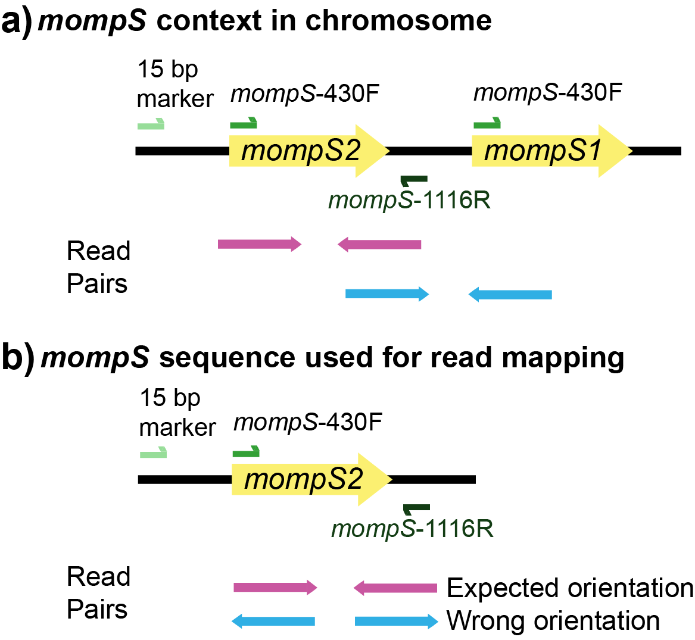

# Approach

At its core, el_gato uses [BLAST](https://blast.ncbi.nlm.nih.gov/Blast.cgi) to identify the closest match in the UKHSA database to each allele from the input data. For the loci *flaA*, *pilE*, *asd*, *mip*, and *proA*, this process is straight forward. el_gato requires more involved processing for *mompS* and *neuA/neuAh* loci, where el_gato only encounters issues with *neuA/neuAh* when processing reads.

* [Reads](#reads)
   * [*neuA-neuAh* and Reads](#neua-neuah-and-reads)
     * [Sequence Diversity](#sequence-diversity)
   * [*mompS* and Reads](#momps-and-reads)
     * [Read Mapping Schematic](#read-mapping-schematic)
* [Assembly](#assembly)
   * [*mompS* and Assemblies](#momps-and-assemblies)

## Reads

When processing reads, identification of both *mompS* and *neuA*/*neuAh* requires additional analyses (described below). The five more straightforward loci (*flaA*, *pilE*, *asd*, *mip*, and *proA*) are processed by mapping the reads to reference loci from [*L. pneumophila* strain Paris](https://www.ncbi.nlm.nih.gov/nuccore/NC_006368.1/) and identifying the consensus sequence. Then, all alleles are determined using BLAST against the [SBT allele database](https://github.com/CDCgov/el_gato/tree/main/el_gato/db).

A couple of quality control steps are applied when processing the reads:

   1. **[Base quality:](https://en.wikipedia.org/wiki/Phred_quality_score)** Any bases with quality scores below 20 are not included when calculating coverage for each position or identifying base calls. 

   2. **[Sequence Coverage:](https://en.wikipedia.org/wiki/Coverage_(genetics))** After excluding low-quality bases, if the generated consensus sequence does not cover 100% of the locus (>= 99% for *neuA*/*neuAh* - see below) at every position, then no attempt to identify the allele is made, and a "-" will be reported. 

### *neuA-neuAh* and Reads

[The sequence of *neuA*/*neuAh* loci can differ dramatically.](https://pubmed.ncbi.nlm.nih.gov/24245827/) Some *neuA*/*neuAh* alleles are sufficiently diverse that reads from some alleles will not map to others. Accordingly, we map reads to six reference alleles that cover the sequence variation currently represented in the SBT database. The six reference alleles used are the *neuA* allele from strain Paris (neuA_1), the *neuAh* allele from strain Dallas-1E (neuA_201), neuA_207, and three other alleles (neuA_211, neuA_212, neuA_215) whose diversity was recognized during the development of el_gato. The reference sequence with the best mapping — highest number of reads that map to a particular reference — is identified using `samtools coverage` with the caveat that >= 99% of the *neuA*/*neuAh* locus must have coverage of at least ten reads per position (some alleles contain small indels, so 100% is too strict); otherwise a "-" will be reported. Once the reference sequence is selected, BLAST processing is the same as described above. 

#### Sequence diversity

  

**Figure 1: *neuA/neuAh* Sequence Diversity -** Demonstration of genetic heterogeneity in *neuA/neuAh*. Numbers in circles are *neuA/neuAh* alleles. Colored circles indicate reference alleles used for read mapping. Diversity between neuA_1 (allele group Paris), neuA_201 (allele group Dallas-1E), and neuA_207 was previously recognized. We identified three additional, highly diverse allele groups (211, 212, and 215), which are included for read mapping. The scale bar represents number of single nucleotide polymorphisms (SNPs). 

### *mompS* and reads

[*mompS* is sometimes present in multiple copies in the genome of *L. pneumophila*, though typically two copies.](https://pubmed.ncbi.nlm.nih.gov/28082190/) Duplicate gene copies pose an obvious challenge for a short read-mapping approach. If two similar sequence copies are present in a genome, reads from either copy may map to the same reference sequence, calling into question which bases are correctly associated with the loci of interest.

el_gato resolves this issue by taking advantage of the proximity of the genome's two copies of *mompS*. [A schematic of the organization of the two *mompS* copies can be found in Fig. 1 in this paper](https://pubmed.ncbi.nlm.nih.gov/28082190/) or [below](#read-mapping-schematic). The sequence context of the two *mompS* copies is such that the typing copy is immediately upstream of the non-typing copy. Only the typing copy is flanked on either side by sequences corresponding to primers used for conventional SBT (primer pairs: *mompS*-430F and *mompS*-1116R). For this reason, only the typing copy is amplified in conventional SBT [(see below schematic)](#read-mapping-schematic). In contrast, while *mompS*-430F sequences are present upstream of the non-typing copy, the corresponding *mompS*-1116R sequences are not found downstream. Thus, a read orientation approach allows el_gato to evaluate which reads belong to the typing *mompS* copy when using short-read sequencing data.  
 
**The sequence of *mompS* is resolved through the following process:**

1. Reads are mapped to the reference mompS sequence (*L. pneumophila* Paris strain, NCBI NC_006368.1), and those aligning to either the typing or non-typing copy of mompS are retained.

2. el_gato examines the nucleotide sequence for each position within reads mapped to *mompS*. If more than 30% of the reads show base heterogeneity at a position, it is considered biallelic. When no biallelic positions are detected, el_gato extracts the *mompS* sequence and uses `BLASTn` to determine the allele number. In contrast, the presence of biallelic positions indicates multiple distinct *mompS* copies. In this case, el_gato identifies individual read pairs that map to biallelic positions and uses them to reconstruct the sequence of each possible allele. 

3. el_gato identifies the typing copy of *mompS* by analysing read orientation relative to two diagnostic sequences flanking the locus. The first is a 15 bp marker upstream of the typing copy (5′-GTTATCAATAAAATG-3′), previously described by [Gordon et al. (2017)](https://pubmed.ncbi.nlm.nih.gov/28082190/). Read pairs containing this marker can therefore be assigned to the typing copy. The second marker, the mompS-1116R primer sequence, lies between the two *mompS* loci and is downstream of the typing copy but only upstream from the non-typing copy. The orientation of reads containing the mompS-1116R primer sequence, relative to the typing copy, is used to infer which copy is the typing locus. For read pairs where one or both reads map to at least one biallelic site, el_gato applies the following rules to assign reads to the typing copy: 

    1. Only one allele has reads with the mompS-1116R sequence in the expected orientation (3′–5′).

    2. One allele has >3× as many reads with the mompS-1116R primer sequence in the expected orientation (3′–5′) compared to the other allele.  

    3. One allele has no reads with the mompS-1116R primer sequence in either orientation, while the other allele has reads with the mompS-1116R sequence in the incorrect orientation (5′–3′). In that case, the allele without the mompS-1116R sequence is considered the typing copy.

    4. Reads from one allele contain the upstream 15 bp diagnostic marker (at the start of the 987 bp *mompS* reference sequence) in the expected 5′–3′ orientation, while the other allele does not. These reads act as secondary evidence that the allele represents the typing copy.

    5. If no reads contain either the mompS-1116R primer sequence with the correct orientation or upstream 15 bp diagnostic marker, el_gato cannot identify the typing copy. 

4. el_gato then uses `BLASTn` to determine the allele number for the typing *mompS* copy. 

If the above process cannot identify the correct sequence, a `?` will be returned as the *mompS* allele, and el_gato will report information about the steps in this process in the [output files](input_output.md/#output-files).

*Note:* The above process depends upon read pairs mapping to biallelic sites and the mompS-1116R primer region, sequence data characteristics such as read length and insert size can impact the ability of el_gato to resolve alleles. 

#### Read mapping schematic

   

  

**Figure 2: Resolving *mompS* Alleles. -** a) *mompS* is sometimes found as multiple copies within *L. pneumophila* and copies may not be identical. Sanger SBT primers target the correct copy. b) el_gato uses primer sequences and read orientation to identify the correct *mompS* allele to include in the SBT profile. 

## Assembly

Six of the seven loci (*flaA*, *pilE*, *asd*, *mip*,*proA*, and *neuA/neuAh*) are identified using BLAST against the SBT allele database. The closest match is returned with an `*` if loci have no exact match. Only *mompS* requires extra when processing an assembly.

### *mompS* and assemblies

[*mompS* is sometimes present in multiple copies in *Legionella pneumophila*, though typically two copies.](https://pubmed.ncbi.nlm.nih.gov/28082190/) When typing *L. pneumophila* using Sanger sequencing, primers amplify only the correct *mompS* locus. We, therefore, use [*in silico* PCR](https://users.soe.ucsc.edu/~kent/) to extract the correct *mompS* locus sequence from assemblies. The primers used for *in silico* PCR are mompS-430F (TTGACCATGAGTGGGATTGG) and mompS-1126R (TGGATAAATTATCCAGCCGGACTTC) [as described in this protocol](https://doi.org/10.1007/978-1-62703-161-5_6). The *mompS* allele is then identified using BLAST against the SBT database. 

*Note:* This method does not perform as well as sequence typing using Illumina reads due to information loss (read orientation and quality metrics) when generating an assembly. Furthermore, because of this lack of information, no additional quality filtering is undertaken in el_gato when the assembly method is used. 
